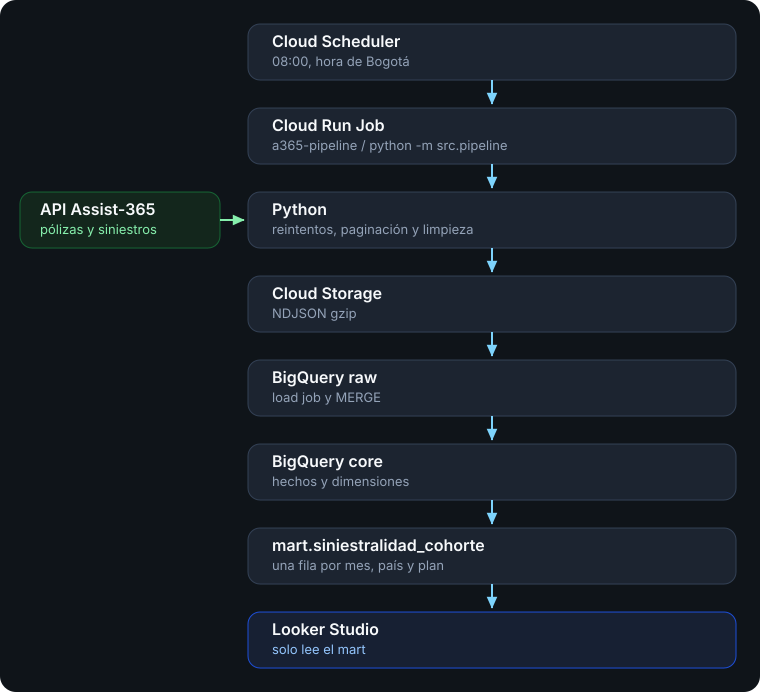

# Assist-365 — de la API al tablero

Pipeline que saca pólizas, siniestros y catálogos de la API interna, los deja en Cloud Storage, los carga en BigQuery y arma un mart chico para Looker Studio. Corre en el proyecto `a365-de-imangini`, con la cuenta `ignacio.mangini43@gmail.com`. El acceso al proyecto vence el **4 de noviembre de 2026 a las 10:37 UTC**.

El código está en [github.com/Igna43/assist-365-pipeline](https://github.com/Igna43/assist-365-pipeline). El token de la API no está en el repo.

## Arquitectura

Cada corrida baja la API, deja el archivo en Cloud Storage y publica el mart que lee Looker. Cloud Scheduler dispara el Cloud Run Job `a365-pipeline` todos los días a las 08:00, hora de Bogotá. El entrypoint del job y de la máquina local es el mismo: `python -m src.pipeline`. El porqué de esa pareja está en Decisiones.



Los datasets viven en la región `US`: `raw`, `core`, `mart` y `ops`. El archivo de cada recurso queda en `gs://a365-de-imangini-raw/raw/{recurso}/{batch}/`.

## Decisiones

### ELT, con una limpieza mínima antes de cargar

El modelo de negocio se arma en BigQuery, después de que el crudo ya está cargado. Python extrae y carga. El grano, el calendario de tipo de cambio, la póliza vigente y el mart son `CREATE OR REPLACE TABLE` en `sql/`.

Antes del archivo, Python solo deja la fila en un tipo que BigQuery acepta: fechas mezcladas a `DATE`, `amount.value` de string a decimal, y `NaN` de moneda a null. Sin eso el load job rechaza el archivo. Esa limpieza no es el modelo.

### NDJSON y no un JSON, un CSV o Parquet

NDJSON es un objeto JSON por línea. BigQuery lo carga nativo con `NEWLINE_DELIMITED_JSON`.

Un solo JSON, el array de 1.003.461 pólizas, es un documento. Hay que tenerlo entero para cerrar el `]` y no se puede ir escribiendo mientras llegan las páginas. El load job de BigQuery no toma ese array como formato de carga. Con NDJSON el extractor abre el archivo y escribe cada página al disco. Si la corrida se corta, lo ya escrito se lee línea por línea.

CSV obligaría a escapar comas y comillas de `detail`, que llega con tres formas distintas. Parquet comprime mejor y es columnar, pero el writer necesita el esquema y una librería extra (`pyarrow`) para un loop que ya produce diccionarios. Serializar una línea y comprimir el archivo con gzip es el camino corto. BigQuery lee el `.ndjson.gz` directo, sin descomprimir afuera.

El archivo pasa por Cloud Storage y entra con un load job, no con streaming insert. Hay un millón de eventos: el load job no se cobra, es atómico y el objeto en `gs://` se puede volver a cargar sin pegarle otra vez a la API. El streaming cobra y tiene cupo por fila, y no deja ese archivo.

### Pólizas incrementales, el resto en foto completa

La póliza tiene cursor y `updated_at`. La segunda corrida manda `updated_since`, tira en el cliente las filas de la página que siguen siendo viejas, y hace `MERGE` por `(poliza_id, updated_at, op)`. El siniestro no tiene feed de cambios: 139 mil filas se reemplazan enteras, igual que los catálogos. Los hechos se reconstruyen siempre desde el log completo, así un `D` o un `U` tardío corrige la póliza vigente aunque el archivo del día sea chico.

### SQL plano, sin dbt

Los tres archivos de `sql/` ya son los modelos. dbt les pondría `ref()`, linaje y los tests al lado de cada modelo. Hoy eso no paga el costo. Hay tres scripts, los tests de `tests/data/` ya frenan el job, y un cambio en la entrevista es editar el SQL y correr `python -m src.pipeline --only transform`. dbt mete un compile, un `profiles.yml` y otro paquete en la imagen del Cloud Run, adelante de esa corrida.

Los tests son consultas que devuelven filas solo cuando fallan, no Great Expectations ni tests de dbt. La superficie que se toca en vivo sigue siendo el mismo SQL del modelo. dbt empieza a convenir si aparecen muchos más modelos, o si alguien tiene que seguir una columna sin leer `src/transform.py`.

### Tipo de cambio con calendario continuo

Un join a la fecha exacta dejaba 215.219 pólizas emitidas sin dólares: el catálogo trae 732 fechas, no todos los días del rango. `dim_tipo_cambio` arma un día por moneda y arrastra la última tasa. El día queda marcado (`exact`, `carried_forward`, `extrapolated_forward`, `extrapolated_backward`, `missing`). No se inventa una moneda cuando el origen trae `NaN`.

### Cohorte de emisión, y la anulada fuera del ratio

El siniestro pagado se cuelga del mes, país y plan de la póliza, no del mes en que ocurrió. "Este trimestre" responde qué se vendió en el trimestre. La prima emitida excluye el estado vigente `ANULADA` porque no hay campo de devolución. Esos siniestros también quedan afuera: si entraran, el costo sumaría y la prima no. Los montos negativos del origen se conservan. El factor de cambio no es negativo, y tirar el monto subiría el costo.

### Looker solo contra el mart

El informe lee la tabla `mart.siniestralidad_cohorte`, 2.304 filas, 0,21 MB. No es una vista sobre el hecho de un millón de filas. Los ratios son `SUM / SUM` de columnas aditivas, así un filtro no promedia porcentajes.

### Un Cloud Run Job, disparado por Cloud Scheduler

La corrida es un batch que termina. `python -m src.pipeline` es el mismo comando en la máquina local y dentro del contenedor: arranca, extrae, carga, arma el modelo, corre los tests y sale. Cloud Scheduler lo vuelve a levantar con un POST, todos los días a las 08:00, hora de Bogotá (`0 8 * * *`). Entre una corrida y la siguiente no queda nada prendido.

Un Cloud Run Service esperaría HTTP todo el día para un trabajo de unos minutos. Cloud Composer levanta un Airflow para un único job lineal, y el orden ya está en `src/pipeline.py`. Una consulta programada de BigQuery correría el SQL y dejaría afuera la API. Una VM con cron estaría prendida las 24 horas.

El job pide 1 CPU, 2 GiB, timeout de 60 minutos y un reintento. Cómo se despliega: el paso 8.

### La cuenta que puede correr el job, y el secreto

Esta cuenta no puede `projects.setIamPolicy` ni habilitar APIs. La service account dedicada `a365-pipeline` solo tiene `storage.objectAdmin` en el bucket. El job corre con la cuenta de Compute, que ya tiene `roles/editor`. Secret Manager no se pudo prender (`serviceusage.services.enable` denegado el 2 de noviembre de 2026), así que el token vive en `.env` y entra al job como variable de entorno en el deploy. No está en git.

### CI sin bodega, tests de bodega en la corrida

GitHub Actions corre `ruff` y `pytest`. No tiene token ni credenciales de GCP. Los doce SQL de `tests/data/` corren al final del pipeline, donde BigQuery ya está, y un fallo tira abajo el Cloud Run Job.

### El MCP al lado del paquete, no encima

El servidor está en `mcp_bigquery/`. Una carpeta `mcp/` taparía el SDK de Python del mismo nombre. `mcp` 2.x rompe FastMCP, por eso el pin es `mcp>=1.9,<2`.

## Paso 0. El secreto, y por qué sigue haciendo falta `.env`

El 2 de noviembre de 2026 se volvió a intentar usar Secret Manager para no guardar el token en un archivo.

1. La API `secretmanager.googleapis.com` no está entre los servicios habilitados del proyecto.
2. `gcloud services enable secretmanager.googleapis.com --project=a365-de-imangini` falla con `PERMISSION_DENIED`. La cuenta `ignacio.mangini43@gmail.com` no tiene `serviceusage.services.enable`.
3. Sin esa API no se puede crear un secreto, ni montarlo en el Cloud Run Job, ni leerlo desde el pipeline.

Por eso el token sigue en `.env` en la máquina local (el archivo está en `.gitignore`) y, al desplegar, `infra/deploy.sh` lo copia a una variable de entorno del job. No se commitea. `.env.example` tiene las mismas claves con el token vacío.

Variables:

| Variable | Valor en este ejercicio |
| --- | --- |
| `A365_API_TOKEN` | Bearer de la API. Solo en `.env` y en el job. |
| `GCP_PROJECT` | `a365-de-imangini` |
| `GCS_BUCKET` | `a365-de-imangini-raw` |
| `BQ_LOCATION` | `US` |
| `A365_API_BASE` | `https://h4zfbym5fd.execute-api.us-east-1.amazonaws.com/v1` |

Si alguien con permiso de habilitar APIs prende Secret Manager, el cambio en el deploy es reemplazar `A365_API_TOKEN` dentro de `--set-env-vars` por `--set-secrets`. Hasta entonces el archivo local es la única forma de no dejar el token en git.

## Paso 1. Autenticación local

Hace falta `gcloud` autenticado contra esa cuenta y las credenciales de aplicación por defecto, porque el pipeline usa las librerías de BigQuery y Cloud Storage:

```bash
gcloud auth login
gcloud auth application-default login
gcloud config set project a365-de-imangini
```

Esta cuenta puede crear buckets, jobs de Cloud Run, schedulers y tablas. No puede cambiar la política de IAM del proyecto (`projects.setIamPolicy`) ni habilitar APIs. Eso condiciona el paso 8.

## Paso 2. Cliente HTTP

`src/client.py` hace `GET` con `Authorization: Bearer <token>` y `Accept-Encoding: gzip`.

- Reintenta 429, 500, 502 y 503, y también un corte de red. Espera con backoff exponencial (arranca en 1 segundo, tope 30) más un jitter. Si la respuesta trae `Retry-After`, usa ese valor.
- El pipeline crea el cliente con 8 intentos (`max_attempts=8`).
- 400 y 401 fallan enseguida. Un 401 es token malo; un 400 en siniestros suele ser un `offset` que no es múltiplo de 500.
- El cuerpo se parsea tolerando `NaN` de JSON (`src/parsing.py`). BigQuery rechaza `NaN`, así que la moneda inválida se guarda como null. No se inventa una divisa.

## Paso 3. Extracción

`src/pipeline.py` arma un `batch_id` con la hora UTC (`20261102T141917Z` en la carga completa) y escribe NDJSON en `data/<batch_id>/`. Esa carpeta está en `.gitignore`. Cada fila lleva `_batch_id` y `_ingested_at`.

El orden es catálogos, siniestros y al final pólizas. Las pólizas son el volumen grande; si fallan, los catálogos de esa corrida ya quedaron en disco.

### Catálogos

Un solo `GET /catalogos?tipo=`:

| `tipo` | Filas | Para qué |
| --- | ---: | --- |
| `productos` | 12 | Nombre del plan, cobertura, tipo, si es premium. |
| `agencias` | 300 | Nombre, país y canal de la agencia. |
| `tipo_cambio` | 5.124 | 732 fechas por 7 monedas, no un día seguido. |

Siempre es foto completa (`mode=full`).

### Siniestros

`GET /siniestros`. No hay cursor de cambios.

- El tamaño de página es 500 y el `offset` tiene que ser múltiplo de 500. El extractor arranca en 0 y suma 500.
- Corta cuando `offset` alcanza `meta.total` o cuando una página viene vacía.
- El total declarado es **138.962**. La corrida completa cargó esa misma cantidad.
- `amount.value` llega como string y se guarda como decimal.
- `amount.currency` puede ser JSON `NaN`. Queda null.
- `occurred_at` y `reported_at` se guardan crudos y también parseados. Si la fecha trae `/`, es `DD/MM/YYYY` (hay días mayores a 12). Si trae `-`, es `YYYY-MM-DD`.
- `detail` tiene tres formas (claves en español, claves en inglés, o solo `proveedor`). Se serializa a un string. No entra al ratio.

### Pólizas

`GET /polizas`. Cursor, 1.000 filas por página, header `x-total-count: 1003461`. El cursor es base64 de `pg:N:a365`. `op` vale `I`, `U` o `D`.

- Sin watermark se recorre todo el log. Es la primera corrida, o cualquier corrida con `--full`.
- Con watermark se manda `updated_since` solo en la primera página. Las siguientes siguen el `next_cursor`.
- `updated_since` salta a la primera página que contiene un `updated_at` posterior, y esa página sigue trayendo filas viejas. `filter_polizas_since` tira las filas con `updated_at` menor o igual al watermark.
- El watermark es el máximo `updated_at` ya cargado en `raw.polizas`, guardado en `ops.watermarks`. Después de la primera carga quedó en `2027-02-10T14:57:00Z` porque hay eventos fechados en el futuro.
- El mismo `poliza_id` puede aparecer varias veces en una página (alta y updates). El crudo conserva todos los eventos. El hecho se queda con uno solo, en el paso 5.

## Paso 4. Archivo, GCS y load job

Por cada recurso con filas, `src/load.py`:

1. Comprime el NDJSON con gzip.
2. Lo sube a `gs://a365-de-imangini-raw/raw/{recurso}/{batch_id}/{archivo}.ndjson.gz`.
3. Lanza un load job de BigQuery con esquema explícito (`src/schemas.py`), formato `NEWLINE_DELIMITED_JSON` y `ignore_unknown_values` en false. Un campo inesperado falla la carga en vez de desaparecer.

Se usa load job y no streaming insert porque hay 1.003.461 eventos de póliza. El load job no se cobra, es atómico y el archivo en GCS se puede volver a cargar. El streaming cobra y tiene cupo por fila.

Cómo se escribe cada tabla:

- Pólizas en modo `full` (no existe watermark, o se pasó `--full`): `WRITE_TRUNCATE` sobre `raw.polizas`, cluster por `poliza_id`.
- Pólizas en modo `incremental`: `WRITE_TRUNCATE` sobre `raw.polizas_stage` y después un `MERGE` a `raw.polizas`. La clave es `(poliza_id, updated_at, op)`. Solo inserta lo que no está. Un solapamiento de página no duplica el evento. Después se borra el stage.
- Si el incremental de pólizas trae 0 filas, no se toca la tabla. Igual se anota la corrida.
- Siniestros, productos, agencias y tipo de cambio: `WRITE_TRUNCATE` de la tabla cruda. El siniestro no tiene feed de cambios y 139 mil filas es una foto diaria chica. Los catálogos son más chicos todavía.
- Siniestros van clusterizados por `claim_id`.

Después de cargar pólizas se actualiza `ops.watermarks`. Cada recurso deja una fila en `ops.extract_counts` con `batch_id`, modo, total de la API y filas escritas. Al terminar bien, `ops.pipeline_runs` recibe `status = ok`. Esas tres tablas las crea `sql/00_ops.sql` con `CREATE TABLE IF NOT EXISTS` antes de leer el watermark, así la primera corrida también pasa.

## Paso 5. Modelo

`src/transform.py` ejecuta tres archivos, en este orden. `${project}` se reemplaza por `a365-de-imangini`. Cada uno hace `CREATE OR REPLACE TABLE`, así que un cambio de SQL en la entrevista se publica volviendo a correr el transform, sin reconstruir un framework.

### `sql/01_dimensions.sql`

- `core.dim_producto`: una fila por `producto_id`. Si el crudo tuviera duplicados, gana el `_ingested_at` más nuevo. `es_premium` pasa de string a bool.
- `core.dim_agencia`: una fila por `agencia_id`, con la misma regla.
- `core.dim_tipo_cambio`: una fila por moneda y por día, del 2023-01-01 al 2028-01-01. El calendario publicado tiene huecos (5.124 filas son 732 fechas, no todos los días entre 2024-01-01 y 2026-10-30). El día sin tasa arrastra la última (`carried_forward`). Antes de la primera tasa publicada usa esa primera tasa (`extrapolated_backward`). Después de la última, sigue con esa última (`extrapolated_forward`). `fx_source` deja escrito cuál de los cuatro casos fue, o `missing` si no hay factor. `is_published` marca el día que sí vino de la API.

Sin ese calendario continuo, 215.219 pólizas emitidas se quedaban sin dólares aunque la fecha de emisión cayera adentro del rango publicado.

### `sql/02_facts.sql`

`core.fct_venta` es **una fila por póliza vigente**.

1. Parte el log por `poliza_id`.
2. Ordena por `updated_at` descendente, después `D` sobre `U` sobre `I`, después `_ingested_at`.
3. Se queda con la fila 1.
4. Si ese `op` es `D`, la póliza no existe más y no entra al hecho.

Columnas que salen de ahí y usa el resto del modelo:

- `fecha_emision` es `DATE(fecha_emision_utc)`. `mes_emision` es el primer día de ese mes.
- `anticipacion_dias` es la diferencia en días entre la emisión y `inicio_vigencia`.
- `cuenta_como_emitida` es verdadero cuando el estado vigente no es `ANULADA`.
- `prima_usd` es `prima * factor_usd` de la moneda de la póliza en la fecha de emisión. La moneda no siempre coincide con `pais_emision`, así que no se convierte por país.
- `fx_missing` es verdadero si no hubo factor.

La primera carga dejó 780.000 pólizas vigentes. De esas, 733.169 cuentan como emitidas y 46.831 están anuladas. El log tiene además 20.000 eventos `D`, que no están en el hecho.

`core.fct_siniestro` es **una fila por `claim_id`** (gana la ingesta más nueva).

- `es_pagado` es `status = PAGADO`.
- `costo_usd` solo se llena en pagados, con `amount_value * factor_usd` de la moneda del siniestro en la fecha de ocurrencia. `RECHAZADO` y `EN_ANALISIS` quedan en el hecho para poder contarlos, y el costo va en null.
- El factor nunca es negativo. Si el monto de origen es negativo, el costo en dólares también. Hay 477 pagados así. Se conservan: tirarlos subiría el costo.
- 313 pagados siguen con `costo_usd` null porque la moneda vino `NaN` y no hay con qué convertir.

### `sql/03_mart.sql`

`mart.siniestralidad_cohorte` es **una fila por mes de emisión, país de emisión y producto**. Solo columnas aditivas, para que Looker arme los ratios con `SUM / SUM` y un filtro no promedie porcentajes.

Entran las pólizas con `cuenta_como_emitida`, con dólares (`NOT fx_missing`) y con `mes_emision`. La prima es `SUM(prima_usd)`. Las pólizas son `COUNT(*)`.

El siniestro pagado se cuelga de esa póliza: mes, país y plan de la emisión, no del mes en que ocurrió el siniestro. Un filtro "este trimestre" responde qué se vendió en el trimestre, que es la pregunta del director comercial. Los siniestros de pólizas anuladas quedan afuera. Si entraran, el costo sumaría y la prima no, y el ratio se infla. Hay 287 pólizas anuladas con un pago, USD 144.639, fuera del ratio a propósito. 4.025 siniestros no matchean ninguna póliza vigente y tampoco entran.

El mart tiene 2.304 filas. `nombre_plan`, `tipo` y `es_premium` se copian del producto para no obligar a Looker a juntar otra tabla.

## Paso 6. Tests que frenan la corrida

Después del modelo, `src/data_tests.py` corre `tests/data/*.sql` en orden de nombre. Cada archivo es un `SELECT` que devuelve filas **solo si la afirmación falla**. Si alguno devuelve filas, el proceso tira `RuntimeError` y el Cloud Run Job queda fallido. No hay un modo de "avisar y seguir".

| Archivo | Qué exige |
| --- | --- |
| `01_fct_venta_unique_poliza.sql` | `poliza_id` único y no nulo. |
| `02_fct_siniestro_unique_claim.sql` | `claim_id` único y no nulo. |
| `03_fct_venta_accepted_values.sql` | Dominios de estado, país y moneda de la venta. |
| `04_fct_siniestro_accepted_values.sql` | Dominios de status, type y moneda del siniestro. |
| `05_siniestros_count_matches_api.sql` | Las filas crudas de siniestros igualan el `meta.total` de esa corrida. |
| `06_polizas_full_count_matches_api.sql` | En una carga full, los eventos de póliza igualan `x-total-count`. |
| `07_no_negative_prima.sql` | No hay prima negativa. |
| `08_paid_cost_keeps_sign.sql` | El factor de cambio es positivo y el signo del costo en dólares respeta el monto de origen. |
| `09_fx_flag_when_prima_missing.sql` | Si la prima en dólares es null, `fx_missing` está prendido. |
| `10_producto_fk.sql` | Todo `producto_id` del hecho existe en la dimensión. |
| `11_agencia_fk.sql` | Todo `agencia_id` del hecho existe en la dimensión. |
| `12_mart_grain_unique.sql` | No hay duplicados de `(mes_emision, pais_emision, producto_id)`. |

El test 08 se reescribió cuando falló con 477 filas. El monto de origen es negativo y el factor no lo es. El test ahora exige conservar el signo, no que el costo sea `>= 0`.

`pytest` no toca BigQuery. Cubre paginación, reintentos, fechas mezcladas, `NaN`, el guard del MCP y dos chequeos estáticos: que el SQL solo nombre los datasets `raw`, `core`, `mart` y `ops`, y que cada test de datos sea un `SELECT` con `WHERE` o `HAVING`.

## Paso 7. Qué dicen los números

El detalle y las tablas están en `analysis/resultados.md`. El perfil crudo está en `analysis/profile.json`. Resumen de la cohorte, en dólares, con las reglas del paso 5:

- El país casi no separa. De por vida: CL 39,6%, CO 39,5%, AR 39,4%, MX 39,3%, BR 38,9%, PE 38,7%.
- Equipaje Protegido (`PRD-11`) destruye margen: prima USD 1.379.686, costo USD 2.039.634, pérdida USD 659.948, siniestralidad 147,8%. La frecuencia es 0,97 veces la del portafolio y la severidad 0,95 veces. No es frecuencia ni monto. El plan está barato. El 74,9% de su costo pagado es un siniestro `MEDICO`, no `EQUIPAJE`.
- Estudiante Larga es el otro plan con pérdida: USD 316.390, siniestralidad 114,7%.
- Frecuencia del portafolio 14,16%. Severidad USD 356,52.
- Insight: las pólizas emitidas con 0 a 2 días de anticipación al viaje tienen siniestralidad 63,7%, contra 33,7% del resto. La frecuencia es 22,7% contra 12,2%. La severidad es casi la misma (USD 360 contra USD 354). Son el 18,7% de las pólizas y el 30,3% del costo pagado. Pasa en todos los canales. En Meta, la compra de último momento llega a 80,3%. Meta con 3 días o más sigue en 43,4%.

## Paso 8. El job diario

El cron y el contenedor están justificados en Decisiones. `bash infra/deploy.sh` hace, en este orden:

1. Lee `.env`. Si no está, corta.
2. Fija el proyecto y desactiva los prompts de gcloud.
3. Crea la service account `a365-pipeline@a365-de-imangini.iam.gserviceaccount.com` si no existe, y le da `storage.objectAdmin` solo sobre el bucket.
4. No le da roles de BigQuery. Esta cuenta no puede llamar `projects.setIamPolicy`, y BigQuery no acepta un binding a nivel de dataset que alcance para todo el modelo. El job corre entonces con la service account por defecto de Compute, `152941963971-compute@developer.gserviceaccount.com`, que ya tiene `roles/editor`.
5. Le da al agente de Cloud Scheduler `roles/iam.serviceAccountTokenCreator` sobre esa cuenta de Compute, para que el scheduler pueda generar el token OAuth del POST.
6. Despliega el Cloud Run Job `a365-pipeline` desde el `Dockerfile` de la raíz (`--source .`), región `us-central1`, 2 GiB, 1 CPU, timeout 60 minutos, un reintento. Las variables de entorno incluyen el token leído de `.env`.
7. Le da a la cuenta de Compute `roles/run.invoker` sobre el job.
8. Crea o actualiza el Cloud Scheduler `a365-pipeline-daily`: `0 8 * * *`, `America/Bogota`, `POST` a `https://us-central1-run.googleapis.com/apis/run.googleapis.com/v1/namespaces/a365-de-imangini/jobs/a365-pipeline:run`.

La imagen copia `src/`, `sql/` y `tests/data/`, y el comando es `python -m src.pipeline`. `.dockerignore` ignora `/data` con la barra inicial, así que los tests de datos sí entran a la imagen y el NDJSON local no.

La segunda corrida, la del día siguiente, no vuelve a bajar el millón de pólizas:

- Pólizas: incremental con el watermark, filtro del lado del cliente y `MERGE`.
- Siniestros y catálogos: se bajan de nuevo y reemplazan el crudo.
- Los hechos y el mart se reconstruyen siempre desde el log completo. Un `D` o un `U` que llegue tarde cambia la póliza vigente aunque el archivo del día sea chico.

`python -m src.pipeline --only transform` y `--only test` no llaman a la API. `--skip-extract` reconstruye el modelo sobre el crudo que ya está. `--full` ignora el watermark y vuelve a traer todas las pólizas.

## Paso 9. Tablero

Looker Studio lee solamente la tabla `mart.siniestralidad_cohorte`. No es una vista sobre los hechos, así que abrir el informe no escanea el millón de eventos.

```bash
bq query --dry_run --use_legacy_sql=false \
  'SELECT * FROM `a365-de-imangini.mart.siniestralidad_cohorte`'
```

Esa consulta procesa **217.152 bytes (0,21 MB)**. El tope del ejercicio es 50 MB.

El conector es el nativo de BigQuery, con las credenciales del dueño. Campos calculados, siempre suma sobre suma:

- `Siniestralidad` = `SUM(costo_siniestros_usd) / SUM(prima_emitida_usd)`
- `Frecuencia` = `SUM(siniestros_pagados) / SUM(polizas_emitidas)`
- `Severidad` = `SUM(costo_siniestros_usd) / SUM(siniestros_pagados)`

Una página, filtro de fecha sobre `mes_emision`. El default del control queda fijo en 2026-07-01 a 2026-09-30, el último trimestre que tiene un mes de emisión. En ese trimestre el país con peor siniestralidad es Colombia (43,5%).

1. Barras de siniestralidad por país.
2. Barras de siniestralidad por plan, con la prima emitida en el otro eje, para que un plan chico no parezca el problema de margen. Top 10 y el resto agrupado como Others.
3. Dispersión: plan, frecuencia en X, severidad en Y, prima como tamaño.
4. Serie mensual de siniestralidad.

Informe:

`https://lookerstudio.google.com/reporting/cf842e57-56b4-4775-88c9-0e8483b97352`

Hay que compartirlo con `gbarrientos@assist-365.com` desde Share. El acceso sigue restringido al dueño.

## Paso 10. Preguntas en lenguaje natural

`SKILL.md` (enlace a `.cursor/skills/assist365/SKILL.md`) es la capa semántica: glosario, grano de cada tabla y la regla de `SUM / SUM`. El agente tiene que consultar `mart` o `core`, nunca `raw`, y decir qué definición se asumió.

El servidor MCP está en `mcp_bigquery/` (no en una carpeta `mcp/`, porque ese nombre tapa el SDK de Python). `.cursor/mcp.json` lo registra como `assist365-bigquery` y `scripts/bq_mcp.sh` lo arranca. No hay secretos en ese JSON: solo el proyecto y la región. Herramientas:

- `list_tables`
- `describe_table`
- `run_select`: un solo `SELECT`. Rechaza DML y DDL. Tope de bytes facturados: 1 GB.

Las cinco preguntas se contestaron hablando con ese servidor. La transcripción (pregunta, tool call, SQL y resultado) está en `analysis/preguntas.md`:

1. Siniestralidad por plan, en dólares.
2. Siniestralidad por país, en dólares.
3. Qué país está peor en el último trimestre con datos.
4. Qué plan destruye margen, juntando siniestralidad y volumen de prima.
5. En ese plan, si el problema es frecuencia de siniestros o monto promedio.

## Paso 11. CI

`.github/workflows/ci.yml` corre en cada push y en cada pull request, con Python 3.12:

```bash
pip install -r requirements-dev.txt
ruff check src tests mcp_bigquery
pytest
```

No llama a la API y no tiene credenciales de GCP. Los tests de warehouse corren dentro del pipeline, donde las credenciales ya están. La corrida de `adb093c` terminó en verde.

## Cómo correrlo en la máquina

```bash
python3 -m venv .venv
source .venv/bin/activate
pip install -r requirements-dev.txt
cp .env.example .env
# completar A365_API_TOKEN en .env; el archivo no se commitea

python -m src.pipeline                 # extract, load, modelo, tests
python -m src.pipeline --only transform
python -m src.pipeline --only test
python -m src.pipeline --skip-extract
python -m src.pipeline --full          # vuelve a bajar todas las pólizas

pytest
ruff check src tests mcp_bigquery
python mcp_bigquery/answer_questions.py
bash infra/deploy.sh
```

`requirements.txt` es lo que usa la imagen. `requirements-dev.txt` suma `pytest`, `ruff` y el SDK de MCP (`mcp>=1.9,<2`; la 2.x rompe FastMCP).

## Qué más hay de raro en los datos

- Las fechas del siniestro mezclan `DD/MM/YYYY` y `YYYY-MM-DD`. La barra es día primero.
- La moneda de la póliza no coincide siempre con el país. La conversión usa la moneda de la fila.
- `updated_since` no filtra por fila. La página del salto incluye registros anteriores al watermark.
- Hay `updated_at` en el futuro. El watermark de la primera carga quedó en 2027-02-10.
- El mismo `poliza_id` aparece más de una vez en una página. El hecho se queda con el último evento.
- Equipaje Protegido paga sobre todo siniestros médicos. El número está en `analysis/resultados.md`.

## Con más tiempo

- Particionar el log de pólizas por día de ingesta y conservar fotos de siniestros, no solo la última.
- Un loss ratio de calendario al lado de la cohorte, para ver el desfase del trimestre que todavía está madurando.
- dbt, cuando el modelo deje de ser tres archivos. Por qué no está ahora: la sección Decisiones.
- Secret Manager, el día que la cuenta pueda habilitar `secretmanager.googleapis.com`.
- El video de diez minutos queda para grabarlo sobre este repo.
